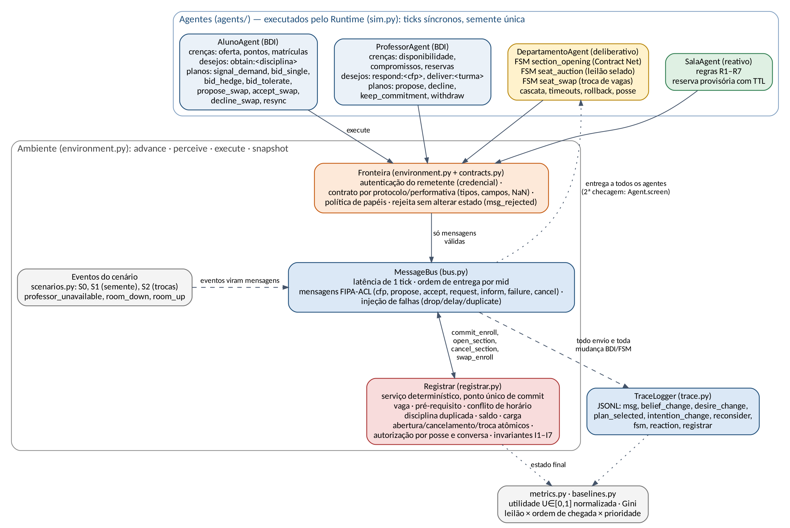

# MatriculaUFSC — DSM3: comunicação, coordenação e protótipo funcional

**INE5628 — Sistemas Multiagentes · Prof. Rafael Luiz Cancian · UFSC**
Autor: Lucas Broering `<preencher matrícula / equipe>`

O que mudou desde a DSM2: [`CHANGELOG.md`](CHANGELOG.md). Protocolos: [`docs/protocolos.md`](docs/protocolos.md). Segurança: [`docs/seguranca.md`](docs/seguranca.md).

Sistema multiagente que simula o **ajuste de matrícula e a oferta de turmas**: alunos disputam vagas com pontos, professores e
departamentos negociam a abertura das turmas, e um Registrar determinístico impede que algo inconsistente seja efetivado.
Implementa o ciclo **perceber → decidir → negociar → matricular** em cenário reduzido, com dados sintéticos (nenhuma regra oficial da UFSC foi consultada).

**Novidades da DSM3:** (1) **autenticação, contratos de mensagem e autorização por posse** nas fronteiras dos protocolos, corrigindo as falhas encontradas no feedback da DSM2 (§5.5);
(2) protocolo **`seat_swap`**: troca atômica de turmas entre alunos, mediada pelo departamento (§5.3); (3) **recuperação de crenças desatualizadas** (`sync`, §5.4);
(4) 213 testes, incluindo adversariais com mensagens duplicadas, atrasadas e concorrentes (§9).

## 1. Como executar

Python ≥ 3.10, sem dependências (`pytest` só para os testes). No Windows, use `py -m` no lugar de `python -m`.

```bash
python -m matriculaufsc --scenario S0 --seed 7 --trace out/trace.jsonl   # cenário controlado (5 alunos)
python -m matriculaufsc --scenario S1 --seed 7 --students 16             # cenário gerado com semente
python -m matriculaufsc --scenario S2 --seed 1                           # troca de vagas entre alunos (seat_swap)
python -m matriculaufsc --scenario S1 --seed 7 --policy compare          # leilão × ordem de chegada × prioridade
python -m matriculaufsc.explain out/trace.jsonl aluno:bruno              # linha do tempo BDI de um agente

pip install pytest
python -m pytest -q                                                      # 213 testes (~8 s)

python scripts/ataques.py                                                # os 4 ataques do feedback (use PYTHONPATH=. no Linux/macOS)
python scripts/experimento_trocas.py                                     # efeito das trocas em 15 sementes
```

Opções: `--pricing first|uniform`, `--no-event` (S0 sem o evento de professor indisponível), `--no-swap` e `--no-sync` (desligam trocas e recuperação de crenças, para ablação). O código de saída é 1 se alguma invariante for violada.
`out/` é apenas onde o `--trace` grava o trace gerado (criada na hora, fora do repositório). Saídas já geradas: [`docs/evidencias/`](docs/evidencias).

## 2. Conteúdo

```
matriculaufsc/          código-fonte (o docstring no topo de cada arquivo explica o seu papel)
  sim.py                runtime por ticks         environment.py       ambiente: perceive/execute/advance/snapshot
  bus.py, messages.py   mensagens FIPA-ACL, falhas (drop/delay)
  trace.py, explain.py  trace JSONL e leitor      scenarios.py, model.py  cenários S0, S1 e S2; dados
  contracts.py          contratos de mensagem, papéis, formato de conversa (DSM3)
  registrar.py          validação, pontos, commit atômico, troca atômica, autorização, invariantes I1–I7
  fsm.py                tabelas de transição dos protocolos (executáveis)
  utility.py, metrics.py, baselines.py   utilidade, métricas e políticas de referência
  agents/               bdi.py (framework), student.py, professor.py, department.py, classroom.py
tests/                  213 testes pytest
scripts/                ataques.py (antes/depois do feedback) · experimento_trocas.py
docs/                   arquitetura.{dot,png,svg} · protocolos.md · seguranca.md ·
                        cenario_S0.md, cenario_S2.md (roteiros conferíveis à mão) · evidencias/
CHANGELOG.md
```

## 3. Arquitetura



| Componente | Tipo | Responsabilidade |
|---|---|---|
| **AlunoAgent** | BDI | quer uma grade satisfatória; sinaliza demanda, escolhe turmas, dá lances, reage a vitórias, derrotas e cancelamentos; **propõe e responde a trocas de turma; recupera o quadro se ficar desatualizado** |
| **ProfessorAgent** | BDI | responde a convites (propose/refuse), mantém compromissos, retira-se se ficar indisponível |
| **DepartamentoAgent** | deliberativo | conduz abertura de turma (Contract Net), leilão de vagas e **troca de vagas** como máquinas de estados; confere a posse de cada mensagem |
| **SalaAgent** | reativo | regras R1–R7: reserva provisória com TTL, recusa se ocupada, confirma/libera |
| **Registrar** | serviço determinístico | **único ponto de commit**: valida, **autoriza** e aplica matrículas, aberturas, cancelamentos e trocas |

**Ambiente** (`environment.py`). Reúne o barramento de mensagens, o Registrar (estado institucional: turmas, vagas, pontos, matrículas) e os
eventos do cenário (`professor_unavailable`, `room_down/up`). Interface: `advance(t)` (injeta os eventos como mensagens `inform`, entrega as mensagens do
tick anterior e deixa o Registrar processar), `perceive(agente)` (só as mensagens endereçadas a ele), `execute(...)` (a ação do agente: enviar uma mensagem, sujeita a perda e atraso)
e `snapshot()` (estado institucional, para métricas e depuração). Os agentes **não leem** o Registrar nem o estado de outros agentes: usam apenas `perceive` (via `step`) e `execute`
(observabilidade parcial), então suas crenças podem ficar desatualizadas; o Registrar mantém a consistência. O código dos agentes só chama `env.execute`, o que um teste confere (`test_environment.py`).
As salas não fazem parte do ambiente: são agentes reativos.

**Runtime.** Simulador próprio em Python puro, com ticks síncronos, em vez de JADE/SPADE. Motivos: (i) reprodutibilidade — latência de 1 tick,
ordem por `mid` e uma única fonte de aleatoriedade (`random.Random(f"{semente}:{turma}:{rodada}")`) fazem a mesma semente gerar o mesmo trace (testado por SHA-256);
(ii) observabilidade — tudo passa por um `TraceLogger`; (iii) injeção de falhas como regra no barramento; (iv) zero dependências.
Perde-se concorrência real, distribuição e compatibilidade com plataformas FIPA; não comparei experimentalmente com JADE/SPADE.

Cada tick: o ambiente injeta os eventos, entrega o que foi enviado no tick anterior e deixa o Registrar processar → cada agente percebe, delibera e age.
Calendário: abertura de turmas em `open_start`=2, rodadas de leilão em 30, 46 e 62 (`model.Config`).

## 4. BDI (anotação 1 do professor)

`agents/bdi.py` implementa o ciclo abaixo; cada passo gera registro no trace.

| Passo | Regra | Registro |
|---|---|---|
| perceber | mensagens → crenças | `belief_change` |
| desejos | derivados das crenças: `active`, `achieved`, `blocked`, `dropped` | `desire_change` |
| reconsiderar | compromisso *single-minded*: a intenção só é reavaliada se uma crença que ela observa mudou; plano inválido → abandonada | `reconsider` |
| deliberar | opções = planos aplicáveis; escolhe o de maior *score*; sem opção → desejo bloqueado | `plan_selected` |
| agir | cada intenção ativa executa um passo | `msg` |

**Aluno**: `signal_demand`, `bid_single`, `bid_hedge` (lance cheio na 1ª turma e metade na 2ª), `bid_tolerate` (aceita horário indesejado com lance 30% menor), `propose_swap` (pede troca), `accept_swap`/`decline_swap` (responde à consulta de troca) e `resync` (pede o quadro atualizado).
**Professor**: `propose`/`decline`, `keep_commitment`, `withdraw` (quando o evento o torna indisponível).

Trecho real (`python -m matriculaufsc.explain docs/evidencias/trace_S0_seed7.jsonl prof:prof_ine1 --tick 44:47`):

```
 45 RECONSID. prof:prof_ine1#3 ABANDONADA — mudou ['available']: plano inválido após mudança de crença
 45 PLANO     deliver:INE1-A: escolhido withdraw entre [['withdraw', 2.0]]
 45 DESEJO    deliver:INE1-A: active → dropped  (compromisso retirado)
```

## 5. Protocolos e consistência

As FSMs estão em `fsm.py`; `Department.go()` verifica cada transição e levanta `InvalidTransition` se ela não estiver na tabela.

### 5.1 Leilão de vagas (`seat_auction`) — anotação 2

`Idle → AguardandoLances → Avaliando → Validando(Registrar) → Concluido | SemLanceValido | Cancelado`

- **Pontos**: cada aluno começa com 100, repartidos entre os desejos ativos por peso. São **debitados no commit** e **reembolsados** se a turma for cancelada; o saldo nunca fica negativo (I6).
- **Lances simultâneos**: ranking por `(−lance, −prioridade, sorteio com semente)`; o Registrar serializa os commits por `mid`. Preço: 1º preço (padrão) ou uniforme.
- **Compatibilidade entre turmas**: se o Registrar acusa violação (`TIME_CONFLICT`, `DUP_COURSE`, `BUDGET`, `PREREQ`…), o aluno é recusado e o próximo da fila é promovido (cascata, até `max_cascade`).
- **Lance tardio** é ignorado e rejeitado. **Turma cancelada**: pontos devolvidos, vagas liberadas, aluno notificado e desejo reativado.

### 5.2 Abertura de turma (`section_opening`) — anotação 4

`Idle → AguardandoPropostas → Avaliando → ReservandoSala → ConfirmandoRegistrar → Aberta | Falha` (mais `Revertendo`)

1. Só abre se a demanda atingir `min_demand`.
2. `cfp` aos professores habilitados; quem propõe cria **reserva provisória com TTL**. O departamento aceita o melhor.
3. Pede a **sala** (reserva provisória com TTL) e, com professor e sala reservados, a abertura **atômica** ao Registrar. Só então envia `confirmed`.
4. **Falhas**: sala recusa → próxima sala ou próximo professor; Registrar recusa → cancela reservas; timeout do Registrar → `cancel_section` **idempotente**; `cancel` perdido → o TTL expira a reserva.
5. **Professor se retira**: o Registrar cancela a turma e reembolsa; o departamento reabre excluindo aquele professor.

As invariantes I1–I7 (`Registrar.invariants()`) valem mesmo com mensagens perdidas (testado com perdas em vários pontos e com o evento injetado em 8 momentos). Um fuzz com perdas, atrasos e eventos
(1500 execuções, fora da suíte) achou uma corrida real — professor se retirando logo antes da rodada de leilão —, corrigida com a transição `Validando → Cancelado`.

### 5.3 Troca de vagas (`seat_swap`) — novo

`Idle → Procurando → AguardandoParceiro → ConfirmandoRegistrar → Concluida | Falha`

Depois do leilão, um aluno que ficou em turma com horário indesejado pode pedir ao departamento a troca por uma turma **cheia** da mesma disciplina que seja estritamente melhor
para ele e sem conflito de horário (`request`). O departamento — o único que sabe quem está em cada turma — consulta, um de cada vez, os alunos dessa turma (`cfp`).
O aluno consultado decide pelo próprio interesse: aceita (`agree`) se a troca **não piora** seus horários nem gera conflito, senão recusa (`refuse`). Com o aceite, o departamento pede ao Registrar
`swap_enroll`, uma troca **atômica**: ou os dois mudam de turma, ou ninguém muda; vagas e pontos não se alteram (cada aluno leva o preço que pagou).

Falhas tratadas: recusa e silêncio do parceiro (próximo candidato), violação detectada pelo Registrar (próximo candidato), resposta do Registrar perdida (**reenvio idempotente**; o Registrar guarda o
resultado por conversa), turma cancelada no meio da troca (`Falha`), pedido de quem não está na turma (negado). Mensagens, estados e tabela de falhas: [`docs/protocolos.md`](docs/protocolos.md).
Roteiro conferível à mão: [`docs/cenario_S2.md`](docs/cenario_S2.md).

### 5.4 Recuperação de crenças desatualizadas (`sync`) — novo

O aluno só conhece as turmas pelo quadro publicado. Ao receber um convite de leilão de uma turma **que não consta** nas suas crenças, ele sabe que está desatualizado: guarda o convite, adota o desejo `resync`
e pede o quadro atual ao departamento (no máximo a cada 6 ticks). Se o quadro chega antes de fechar a janela de lances (`bid_window`), ele ainda responde ao convite guardado; senão volta a participar na rodada seguinte.

### 5.5 Autorização e validação nas fronteiras — novo

Na DSM2 o Registrar e o Departamento confiavam no `sender` e no formato do conteúdo. As quatro falhas do feedback (cancelamento por remetente inexistente, falsa retirada de professor, custo `NaN`,
requisição sem `op`) foram **reproduzidas no código da DSM2** e corrigidas em três camadas: (1) o Ambiente autentica o remetente por credencial e aplica o contrato e a política de papéis
(`contracts.py`); (2) cada agente revalida o que chega (`Agent.screen`); (3) o dono do estado confere a **posse** — só o departamento dono da disciplina altera a turma no Registrar, só o professor responsável retira a turma,
cada `conv` precisa corresponder à operação. Mensagem inválida é descartada e registrada (`msg_rejected`, `msg_invalid`, `msg_denied`, `registrar_denied`), sem alterar estado.

| Ataque | DSM2 | DSM3 |
|---|---|---|
| `cancel_section` em nome de aluno inexistente | turma cancelada; nenhuma invariante acusou | estado intacto |
| falsa retirada de professor | turma cancelada e horários do professor bloqueados | estado intacto |
| matrícula com custo `NaN` | saldo `nan` (I6 acusa depois) | estado intacto |
| requisição sem `op` | `KeyError` interrompe o processamento | estado intacto |

Saída completa: [`docs/evidencias/ataques_dsm2_vs_dsm3.txt`](docs/evidencias/ataques_dsm2_vs_dsm3.txt). Modelo de ameaça, camadas e limites (a autenticação é **simulada**): [`docs/seguranca.md`](docs/seguranca.md).

## 6. Utilidade (anotação 3)

`U = 0,60·R + 0,25·S + 0,15·E`, todos os termos em [0,1]: R = obrigatórias obtidas/desejadas; E = eletivas obtidas/desejadas (teto 1);
S = 1 − (horas em horário indesejado / horas da grade). Logo `U ∈ [0,1]` (testado com 2000 entradas aleatórias). Satisfatória: `U ≥ θ = 0,70`
(sem nenhuma obrigatória, U ≤ 0,40; com metade das obrigatórias e horários perfeitos, U = 0,70).

## 7. Cenários e interação

**S0 — controlado (depuração)**: 5 alunos, 2 departamentos, 3 professores, 4 salas, 6 turmas. Cada elemento provoca um comportamento conferível à mão
(disputa, cascata `DUP_COURSE`, recusa de sala, turma sem demanda, professor indisponível → cancelamento → reembolso → reabertura).
Roteiro e resultados esperados em [`docs/cenario_S0.md`](docs/cenario_S0.md).

Interação ponta a ponta: tick 0 alunos sinalizam demanda → 2 `cfp` dos departamentos → 8–10 cinco turmas abertas (INE4-A não abre) → 30–31 oferta e `cfp` do leilão
→ 34 Registrar recusa `davi` em MTM1-B (`DUP_COURSE`) e `eva` é promovida → 44 `prof_ine1` indisponível → 45 retirada, cancelamento de INE1-A e reembolso
→ 54 reaberta com `prof_ine2` → 62 rodada 2 → 68 alunos matriculados.

**S2 — troca de vagas**: 4 alunos, 1 disciplina, 2 turmas (§5.3 e [`docs/cenario_S2.md`](docs/cenario_S2.md)). u2 fica numa turma com horário indesejado (U = 0,75); a troca com v1 a leva a U = 1,00 e não piora ninguém.

**S1 — reduzido, gerado com semente**: 2 departamentos, 8 disciplinas, 12 turmas planejadas, 5 professores, 5 salas, N alunos (padrão 16) em 3 fases. Com a semente 7, 8 das 12 turmas abrem.

## 8. Comparação distributiva

`--policy compare` roda o leilão e duas políticas de referência (`first_come`, `priority`) **sobre as mesmas turmas abertas**, com o mesmo Registrar. S1, semente 7, 16 alunos:

| métrica | leilão | ordem de chegada | prioridade |
|---|---|---|---|
| U médio | 0,716 | 0,709 | 0,709 |
| % grades satisfatórias | 62,5 | 62,5 | 62,5 |
| Gini de U | 0,115 | 0,122 | 0,113 |
| U médio, menor prioridade | 0,789 | 0,773 | 0,781 |
| U médio, maior prioridade | 0,644 | 0,644 | 0,636 |

Em 15 sementes o leilão tem U médio e Gini um pouco melhores, mas **menos** grades satisfatórias que a ordem de chegada (48,8% × 52,9%). Um cenário gerado, sem teste estatístico:
é um indício, não uma conclusão.

**Efeito das trocas** (`scripts/experimento_trocas.py`, S1, 16 alunos, 15 sementes, leilão com × sem `seat_swap`): U médio 0,664 × 0,663; satisfatórias 49,2% × 48,8%; Gini igual (0,159).
Houve 4 pedidos de troca em 15 sementes e 3 foram concluídas, melhorando o U médio em 3 sementes e nunca piorando; custo de ~2,5 mensagens por semente. O efeito é **pequeno** (as oportunidades de troca são raras neste cenário) e a conclusão não é estatística.
Saída: [`docs/evidencias/experimento_trocas.txt`](docs/evidencias/experimento_trocas.txt).

## 9. Testes e rastreabilidade

`python -m pytest -q` → 213 testes ([`docs/evidencias/testes.txt`](docs/evidencias/testes.txt)). Sem rede nem API paga; mesma semente, mesmo trace (o S0 com semente 7 é idêntico ao da DSM2).
Os requisitos são os da DSM1; o nome do teste crítico contém o id (`T_XXX_NN`) e `test_traceability.py` falha se um requisito implementado ficar sem teste.

| Requisito | Descrição | Testes |
|---|---|---|
| REQ-F01 | toda solicitação aceita termina em estado terminal | T-PROT-01, T-SCEN-01 |
| REQ-F02 | só lances válidos e dentro da janela contam | T-PROT-02, T-PROT-03 |
| REQ-F03 | aluno decide onde e quanto ofertar | T-BDI-01, T-BDI-02 |
| REQ-F04 | trocas atômicas entre alunos | T-SWAP-01…20 |
| REQ-F08 | crenças desatualizadas são recuperadas | T-SYNC-01…06 |
| REQ-F05 | demanda não atendida leva à abertura de turma | T-OPEN-01 |
| REQ-F06 | professor propõe ou recusa, sem exceder a carga | T-BDI-03, T-OPEN-02 |
| REQ-F07 | eventos geram reconsideração observável | T-EVT-01 |
| REQ-S01 | sem violar pré-requisito, horário ou carga | T-REG-01 |
| REQ-S02 | matriculados ≤ vagas ≤ capacidade da sala | T-REG-02 |
| REQ-S03 | reservas de sala sobrepostas são recusadas | T-ROOM-01 |
| REQ-P01 | lances e preferências privados | T-PRIV-01 |
| REQ-O01 | todo requisito crítico tem teste rastreável | T-TRACE-01 |
| REQ-O02 | toda mensagem é registrada | T-OBS-01 |
| REQ-R01 | baseline e SMA nos mesmos cenários e sementes | T-REPRO-01 |
| REQ-X01 | remetente autenticado, papel e posse conferidos; operação inválida não altera estado | T-SEC-01…18 |
| REQ-X02 | robustez a mensagens duplicadas, atrasadas, concorrentes e caos aleatório | T-ADV-01…09 |

Os demais testes (`test_utility`, `test_bus`, `test_auction`, `test_fsm`, `test_registrar`, `test_environment` e parte de `test_bdi` e `test_section_opening`) são de apoio dos componentes e não têm id de
requisito — um desvio da regra "nenhum teste sem requisito" da DSM1.

## 10. Limitações

- **Trocas só entre alunos da mesma disciplina** (turmas diferentes da mesma disciplina), um parceiro por vez, e o parceiro aceita apenas se não piorar; não há troca de disciplinas diferentes nem contrapartida em pontos.
- **Dados sintéticos e modelo simplificado**: slots de 1 hora, um período, sem regras oficiais da UFSC.
- **Estratégia de lance simples**: o aluno reparte o saldo entre os desejos ativos por peso, com regras fixas (`bid_single`, `bid_hedge`, `bid_tolerate`); sem aprendizado.
- **Crenças podem ficar desatualizadas** sob perda de mensagens. Há recuperação só para o **quadro de turmas do aluno** (`sync`); outros casos (ex.: o professor não saber que a turma foi confirmada) dependem de TTL e reenvio, sem ressincronização geral.
- **Autenticação simulada**: a credencial é emitida em memória pelo Ambiente; num sistema real seria assinatura ou canal autenticado. Um agente com acesso ao código da infraestrutura está fora do modelo de ameaça.
- **Registrar é ponto único de falha** e não falha no modelo. Sala que cai *depois* de confirmada não é tratada.
- **Sem persistência**: crenças e estado ficam em memória (CP9 parcial); sem aprendizado nem memória entre execuções.
- **Desempate**: a prioridade entra antes do sorteio, favorecendo fases mais altas; a ordem de commit entre turmas segue a ordem de envio dos departamentos.
- **Comparação com baselines indicativa** (§8); as baselines usam turmas já abertas pelo SMA.
- **Concorrência simulada**: um processo, ticks síncronos.
